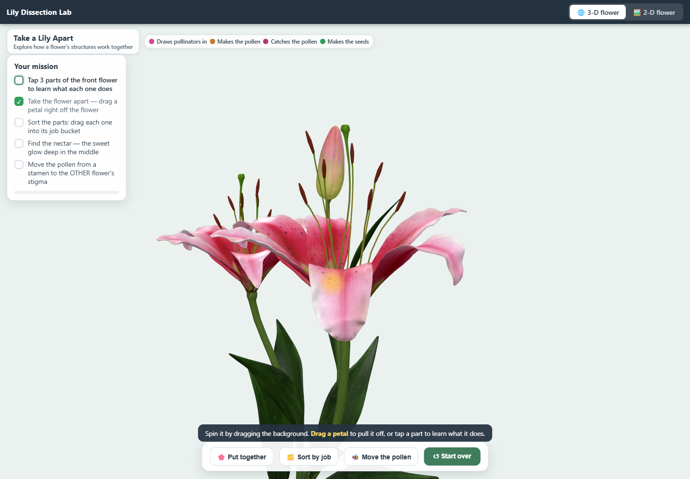
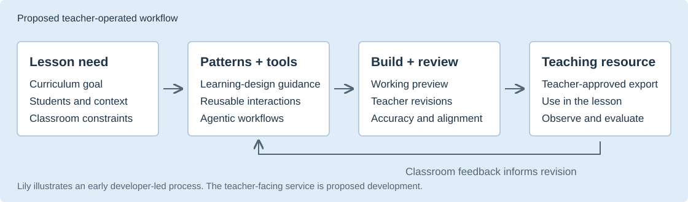

# Personalized STEM Resources

A speculative prototype for an AI authoring tool that helps teachers talk a curriculum-aligned STEM resource into existence.

I want teachers to describe what their class needs, see a working preview, and refine it through conversation. Learning-design patterns would guide the choices behind the resource, while prebuilt tools would supply interactions such as exploration, sorting, and modeling. The teacher would decide what to use in the classroom.

This repository contains the first module, **Lily Dissection**, and the proposal for developing the broader authoring tool through the 2027 Tools Competition's Catalyst program.

## Start here

Open [index.html](index.html) in a browser for an illustrated overview, or go directly to the [Lily module](modules/lily-dissection/index.html). The module opens from disk in 3-D, with a 2-D option and automatic fallback. It needs no installation or internet connection.

- [Prototype walkthrough](docs/tools-competition-2027-activity-teardown.md): screenshots, design choices, and the work ahead.
- [Competition proposal](docs/tools-competition-2027-proposal.md): the Phase I draft for Strengthening Teaching, Catalyst level.
- [Module source and build instructions](modules/lily-dissection/README.md).



## What the prototype tells us

I built the initial Lily application for a teacher's need in under four hours, using conversational AI, agentic workflows, and a rudimentary Learnability Patterns knowledge source. That is my account of the initial build; the current module includes later refinements.

The useful starting point is the authoring process: a teacher's lesson and constraints shaped a small, working application. Lily currently has one user. Three teachers are providing feedback on the broader work.

The next step is to make this process usable by teachers themselves. This repo contains a working instructional resource; the conversational authoring service and reusable tool library are proposed development.

## The proposed authoring process



"Personalized" means fitted to the teacher's learning goal, lesson, students, and practical constraints. A resource might need a simpler explanation, a different interaction, or an offline format. Individual student adaptation would require additional development and evaluation.

In Lily, the lesson goal led to a focus on how structures work together in pollination. A task sequence, visible pollen route, and explanations give concrete examples of guidance the pattern source can inform. These are design choices to investigate, rather than established evidence of learning gains.

## What Catalyst would support

The funding would support a teacher-facing authoring experience, a stronger learning-pattern knowledge source, a small collection of reusable STEM tools, and a structured pilot. We would measure total preparation and revision time, developer assistance, scientific accuracy, curriculum fit, and classroom usability. Student explanations would help us examine whether the interactions support the intended concepts.

The main question is whether teachers can independently create useful resources with this workflow, and how it compares with general-purpose AI on the same lesson requests.

## Repository layout

```text
index.html                 Illustrated project overview
docs/                      Proposal and prototype walkthrough
modules/
  lily-dissection/         First working module, assets, sources, and builds
```

Each module keeps its lesson-specific source and assets together. The Lily HTML files are generated from templates; edit the module source and rebuild them. Adding another module does not require changing Lily's implementation. See [module conventions](modules/README.md).

## Attribution and publication status

The prototype was built with AI assistance. The documentation describes both the working resource and the planned authoring tool. Lily is an independent supplement informed by OpenSciEd Grade 4 Unit 4.4, Lesson 13; it has no OpenSciEd endorsement.

See [third-party notices](THIRD_PARTY_NOTICES.md) for curriculum and software credits. The 3-D illustration uses a purchased model under a separate commercial license. This review repository starts with fresh history and excludes private source inputs. A project-wide open-source license has not been selected.
