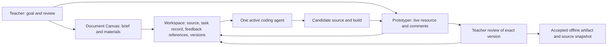

# Teacher-builder authoring workflow

Date: 2026-10-20\
Status: Design for a first assisted trial; not implemented or empirically validated.\
Scope source: [session brief](authoring-workflow-session-brief.md). Peter explicitly selected a teacher with Peter assisting as the first population. The specific lesson request and trial thresholds below are proposed design choices, pending a participating teacher's actual need.

Follow-through: [rehearsal findings and bounded plan](plan-authoring-rehearsal.md) records targeted operator probes later on October 20. The keyboard prerequisite failed; the teacher trial and provider-continuity test remain unrun.

## 1. Problem and first scenario

A teacher needs to adapt an interactive resource to a lesson, inspect what the agent made, and retain a usable result. Today that process depends on the operator remembering context across files, chat, preview, and feedback. Changing agents risks losing why an edit was requested or which version was reviewed. Without this work, Peter can continue making individual resources, but we cannot evaluate a repeatable teacher-builder workflow.

The first participant is a teacher who owns instructional decisions, with Peter available for technical setup and assistance. A Peter-only rehearsal precedes the teacher session. Neither establishes independent teacher authoring.

**Proposed task:** adapt the standalone 2-D Lily activity for a short Grade 4 lesson segment. The teacher requests clearer directions and an explanation prompt, reviews the running result, requests one contextual revision, and retains an offline classroom file.

Illustrative request, not a quotation from an actual teacher:

> Help my students explain how pollen moves from an anther to a stigma. Make the directions easier to follow, and add a question that asks students to use what they observed. Keep the resource usable without internet.

Proposed student explanation: “Where did the pollen start and end? How did those structures help it move or stay there? What does this model leave out?” The teacher can change the wording and lesson fit. Oral explanation or a paper drawing is sufficient; no student accounts, response database, automated scoring, or mastery badge.

Use the existing **within-one-bloom 2-D case** explicitly. Do not present it as transfer between flowers or as proof that this cultivar forms seeds after self-pollination. This selection reduces dependencies for the first workflow trial; it is not an educational judgment that 2-D is better. If the teacher's actual aim requires transfer between flowers, reopen this scope and include the 3-D route and its export checks.

Inputs: a short teacher-owned brief, existing module source, selected reference material, and any feedback the teacher actually supplies. Outputs: adapted 2-D HTML, a short teacher note explaining the model's limits, the accepted source snapshot, and a record of requests, revisions, assistance, and checks.

### Scope boundaries

| In the first loop | Deferred |
|---|---|
| One lesson workspace, one selected resource, one editing agent at a time | Multi-user collaboration, simultaneous editing agents |
| Brief/material selection, preview, contextual feedback, revision, recovery, export | General file manager, asset marketplace, course/LMS management |
| Existing conversational CLI, with Peter assisting | Dedicated teacher chat UI and hosted accounts |
| Explicit file-based handoff among Codex, Claude Code, and agy | Native transcript migration or interchangeable provider session IDs |
| Offline student artifact | Offline agent inference or offline authoring-service claim |
| Accuracy and accessibility checks for the chosen route | Full cross-device/accessibility certification, learning-effect claims |
| Current module adapted from source | New module, reusable interaction library, fine-tuning |

The exact classroom request and device/input setup must be recorded before a teacher trial. No participant is recruited or scheduled by this design.

## 2. Pre-mortem

Imagine the first assisted trial has finished and failed:

| Failure | Observable symptom | Design response |
|---|---|---|
| Peter did the authoring while the teacher watched | Peter writes the request, chooses revisions, or accepts the resource | Teacher performs instructional decisions; log every intervention, including prompts and recovery |
| Preview shows the old private Lily tree | Changes in this checkout never appear, or export differs from reviewed preview | Identify workspace by absolute root and selected entry file; verify a harmless fixture change before the session |
| Agent switch loses an unresolved request | Incoming agent redoes accepted work or asks Peter to reconstruct rationale | Portable brief, task record, feedback references, snapshots, and explicit incoming acknowledgment |
| Two terminals keep writing | An old agent changes files after the next agent starts | Stop and verify the outgoing writer before ownership transfer; closing the canvas is insufficient |
| A terminal says “done,” but the artifact is stale | Source changed but HTML did not rebuild, or a browser tab still shows old output | Bind review and acceptance to source/output hashes and an explicit reload |
| Teacher changes the brief during generation | A revision silently implements an earlier goal | Bind each run to its input revision; preserve the newer edit and mark the result for reconciliation |
| The activity looks successful but teaches the wrong thing | Pollen arrival implies immediate seed formation; action completion is called learning | Review all visible feedback, animations, and prompts; keep instructional and technical acceptance separate |
| Works only inside the prototyper | Export needs injected scripts, local servers, or overlay state | Review and exercise the exported HTML separately with network disabled |

## 3. Definition of done

The first loop is feasible when a teacher can state the lesson need, inspect the adaptation, submit one anchored change, judge the revised result, and reopen the accepted export. Peter may handle environment setup, builds, and agent operation, but each intervention is visible in the evidence.

Proposed feasibility thresholds are experiment rules, not prior results or estimates of expected performance:

- One Peter rehearsal passes the technical/recovery tests before inviting a teacher.
- One assisted teacher completes the loop within a **60-minute observation session**, excluding a separately timed initial installation/setup. Include agent waiting, review, and recovery in the 60 minutes. Record unfinished work at the limit; completing it later does not retroactively pass the session.
- Teacher owns all five instructional actions: articulate goal, choose requested adaptation, inspect candidate, request revision, accept/reject final resource. Peter replacing one of these is recorded as failure of this task-ownership criterion.
- Zero lost saved edits, unresolved critical scientific errors, or broken required interactions in the accepted export.
- Reopening identifies the accepted version and outstanding feedback within **five minutes**, using workspace records only.
- Each agent can receive and hand off a bounded revision with no oral reconstruction of lesson rationale or hidden dependence on another provider's chat.

Passing supports only “one assisted authoring loop was feasible under these conditions.” Teacher independence, comparative cost, generalizability, learning gains, and Learnability Patterns' contribution need separate evidence.

## 4. Explicit unknowns and decision gates

| Unknown | Accepted consequence / next evidence |
|---|---|
| Actual teacher request and device differ from the proposed scenario | Confirm in the brief before trial; change the chosen view if the instructional goal requires it |
| Two surfaces and a terminal may be confusing even with assistance | Log misnavigation and help; if the teacher cannot complete their five actions, revisit interaction design before another trial |
| AGY is not wired into the WSL drawer according to the prototyper handoff | Probe its published native interface and path behavior before its adapter test; report two-provider coverage if the third remains blocked |
| Runtime behavior may differ from handoffs | Test installed versions, paths, prompts, and restart behavior in a disposable workspace; no current combined-runtime claim |
| 2-D keyboard support may block the target route | Test before teacher use; a needed keyboard-equivalent path becomes a scoped prerequisite, not an assumed existing capability |
| Feedback anchors may drift after revision | Preserve original context and version; require explicit re-anchoring or a page-level request |
| Raw feedback and full production costs are unavailable | Do not infer them from reported user counts or initial build time |
| A future custom model may not operate coding tools reliably | Preserve the contract, but require a new adapter and the same evaluations; fine-tuning alone is insufficient |

These unknowns do not prevent design or a disposable rehearsal. Teacher trial entry requires the actual brief/device, baseline operation, recovery, and export checks. Three-provider interchangeability requires evidence from all three; it is not a prerequisite for learning whether a teacher can use one supported agent.

## 5. Canvas design and ownership

### Start with connected existing surfaces

Use Document Canvas for the brief, selected materials, and review summary. Use niu-prototyper for the **built standalone 2-D file** and interface comments. The authoring workspace is the files and records they share. A short workspace page provides the selected resource, current task, version labels, and links to the two surfaces.

For the first experiment, this is a configured workflow with manual coordination by Peter. It does not require a new shell, a conversation server, or an agent framework. Links to authenticated local sessions stay in local state, never in committed documents or classroom exports.



The arrows describe the workflow; there is no implemented synchronization service.

Conceptual information layout (labels, not a promise of new controls):

```text
Lesson: Lily / selected view: 2-D
State: working candidate r2          Accepted classroom version: r1

Materials                     Work area                         Review
  Lesson brief                Brief OR live preview             Open requests
  Selected references         Model limits visible              Agent replies
  Teacher note                Candidate/accepted label          Accept / revise decision

Conversation: one active agent; current request; progress or assistance needed
Versions: accepted r1 | candidate r2 | exported copy of r1
```

In the rehearsal, the workspace page and records supply the labels; existing tabs supply the work area; the existing terminal supplies conversation. Acceptance and export are recorded actions performed with Peter's help, not existing canvas buttons. Teacher navigation/assistance is part of what is being tested.

| Responsibility | Owner |
|---|---|
| Learning goal, material selection, instructional acceptance | Teacher |
| Setup, process ownership, native launch, build/export assistance, evidence collection | Peter in the assisted trial |
| Documents, document revisions, document feedback lifecycle | Document Canvas |
| Running resource, UI anchors, static reload, UI feedback lifecycle | niu-prototyper |
| Shared terminal discovery/launch/input behavior | Document Canvas engine; prototyper consumes its locked copy/recorded ports |
| Lesson source, prompts, model limits, test cases | This STEM repository |
| Implementation of a requested revision | Exactly one active coding agent |

Do not edit the prototyper's locked terminal core locally. Reusable improvements belong in their existing tool repositories, with their own tests and release procedure. Do not add STEM-specific behavior to either engine.

### Why not a shared shell yet?

| Option | What it establishes | Decision |
|---|---|---|
| Native agent + plain browser/files | Lowest integration cost; useful comparator for coordination overhead | Keep as fallback and later comparison |
| Existing document and live-preview surfaces + explicit workspace record | Tests contextual feedback, recovery, and handoff with current tools | First experiment |
| New shell with integrated teacher chat | Could reduce navigation burden; adds transport, state, and process work before teacher evidence | Revisit if observed failures arise from navigation or conversation controls |

**Insight — contract boundary (established engineering practice, applied here as a design hypothesis):** preserve the work product and decisions outside the agent session. This makes a provider replacement testable. A common terminal appearance alone cannot establish continuity. A new shell could hide a broken handoff without fixing it.

## 6. Minimal workspace and revision model

Use an isolated trial checkout or copy under `C:/Users/pniu/Projects` or local scratch. Preserve this checkout's existing uncommitted work. Do not migrate or synchronize the original private Lily tree. The runtime's WSL `/mnt/c/...` and Windows paths must resolve to the same trial root.

Minimum state, initially ordinary Markdown plus files:

| Record | Required content |
|---|---|
| `brief.md` | Teacher goal, context, selected view, constraints, required interactions, scientific limits, sources, success criteria |
| `workspace.md` | Workspace ID/root, selected resource source and build entry, current task, active owner, candidate/accepted/exported revision references |
| `tasks/<id>.md` | Request, input snapshot, feedback IDs/context, run status, agent identity, changes, checks, unresolved questions, handoff |
| `revisions/<id>/` | Recoverable changed source plus required baseline references, built artifact, manifest of relative paths/hashes, review decision and reviewer |

These are proposed trial-local paths, not files created by this Design session. Trial state, `.document-canvas/`, `.niu-prototyper/`, private materials, and runtime URLs must be excluded from commits and exports before launching tools. Do not rely on global ignore settings. Retain sanitized protocol/findings in `docs/`; this is project documentation, not a new personal knowledge system.

Workspace management initially means selecting the registered brief/materials, locating the selected resource, distinguishing candidate from accepted output, reopening state, and exporting an accepted revision. It excludes arbitrary filesystem browsing or destructive file operations.

Both tools retain their own authoritative comment stores. The task record references comments as `(tool, workspace, batch, comment)` and records original context, reviewed artifact revision, requested change, and disposition. Capture relevant sent feedback into the packet before handoff so it remains intelligible without a live server. Do not scrape or migrate native conversations. Unsent browser drafts are not part of a handoff: save/send them first or explicitly record that they were withheld.

Document feedback uses Canvas revision-checked APIs. Resource code changes occur in the isolated trial source, with a baseline snapshot and one writer. A candidate build must succeed before preview switches to it. Keep the last accepted artifact immutable. Rejecting a candidate selects the accepted copy; it never resets or deletes newer source.

Proposed lifecycle:

```text
requested -> running -> ready-for-review -> accepted -> exported
                   \-> needs-input / failed / interrupted
ready-for-review -> revision-requested -> new task based on a recorded revision
```

“Addressed” is an agent reply; “resolved” belongs to the teacher. A completed provider turn is not “accepted.” Export records the accepted artifact's identity; it does not create a new instructional approval.

## 7. Agent boundary

The first boundary is a **portable work packet**, consumed through each agent's supported native interface. Peter may launch agents and record observed statuses manually. Do not represent this as an implemented automatic adapter.

| Direction | Minimum contract |
|---|---|
| Request to agent | Contract version; task/workspace IDs; exact root and relative edit scope; request; brief/input hashes; selected resource and source/build paths; relevant feedback with original context; accepted/candidate references; required checks |
| Agent acknowledgment | Task ID, resolved root, input revision, understood goal/constraints, claimed editing ownership; mismatches block edits |
| Progress | Task/run ID, observed status, short progress or blocker, outstanding question; optional provider log/session reference |
| Result | Changed paths and source/output hashes, candidate location, changes explained against request, checks with actual outcomes/evidence, unaddressed feedback and limitations |
| Handoff | Outgoing task state, last usable revision, partial edits, next bounded action, pending questions/claims, process stopped or explicitly unknown |

Paths in the packet are workspace-relative except for the launch root. References must resolve inside that root or explicitly registered read-only materials. References to native sessions are diagnostic only. A new agent must work from the packet without that session.

The write-scope list is an operating rule, **not a sandbox guarantee**: current local terminals have the user's shell permissions. Preserve native approval controls. This is trusted, local, assisted authoring; do not tunnel the terminal service or portray it as hosted teacher software.

### Failure, cancellation, and switching

1. Save/send the teacher's pending edits and comments; record their revisions.
2. Ask the current agent to stop and summarize. Peter verifies the editing process and any spawned writer have stopped; closing a tab, stopping a canvas server, or seeing a final message does not suffice.
3. Preserve partial files and the latest accepted artifact. Mark the task `interrupted` if completion cannot be established. A lost connection yields unknown status until inspected.
4. Release review claims through the owning tool while the original owner is available. If a crashed owner leaves a claim, stop takeover until its state is reconciled; never impersonate that owner or edit tool databases directly.
5. Compare the current files with the run's baseline. A human change or stale brief requires explicit reconciliation before acceptance; do not silently overwrite or launch a second writer.
6. Incoming agent reads the packet, acknowledges the root/revision/open feedback, and performs the next bounded task. Use a fresh native session for the portability test.

Duplicate delivery of a task ID must not trigger a second revision: inspect the task record first, return the existing candidate if complete, or reconcile an interrupted run before retry. This is a manual rule in the first rehearsal. Automatic fencing, deduplication, crash recovery, and lifecycle events are later implementation work only if required by the observed workflow.

### Provider integration evidence and limits

Codex documents non-interactive execution and JSONL events; Claude Code documents programmatic execution and structured/streaming output. These provide possible future adapter entry points, but do not establish shared schemas, identical approvals, or cross-provider resume. Installed versions must still be probed. [OpenAI documentation](https://learn.chatgpt.com/docs/non-interactive-mode), [Claude Code documentation](https://code.claude.com/docs/en/headless).

The local prototyper handoff reports Linux Codex and Windows Claude through WSL, and agy not yet wired on this machine. Its generic Gemini menu is not evidence of working Antigravity support. Do not substitute Gemini CLI for agy and count that as passing. For an initial AGY test, a verified native published CLI with the same work packet is acceptable; drawer parity is a separate result. A custom education model would implement this boundary through its own tools/runtime and undergo the same tests.

## 8. Tests and retained evidence

At the time of this design, all tests below were planned. The [follow-through record](plan-authoring-rehearsal.md) now distinguishes completed subsets from failed and unrun tests; no whole-matrix pass is claimed. Proposed times and sample sizes are feasibility choices. Record failures as failures; retain the original result when a later fix passes.

| ID / mode | Procedure | Pass criterion | Evidence |
|---|---|---|---|
| T0 — operator + filesystem | Identify trial root, build baseline, launch selected 2-D target; make/revert a harmless fixture change in the disposable copy | Preview is demonstrably built from that copy; original/private trees untouched; baseline checks recorded | Resolved roots, source/output hashes, build result, preview identity |
| T1 — human observation | Teacher performs brief -> request -> candidate -> anchored feedback -> revision -> accept -> export | Five teacher-owned decisions completed within 60 minutes; all assistance and waiting counted | Timeline, intervention log, task records, artifact |
| T2 — restart/recovery | Save state, close tabs and stop/restart surfaces, reopen using recorded workspace | Within five minutes recover selected lesson, accepted/candidate versions, and all sent unresolved feedback; no lost saved edit | Before/after IDs and hashes, time, recovery steps |
| T3 — provider continuity | On bounded revisions, run Codex -> Claude -> agy -> Codex, each in a fresh session, one writer at a time | Each recipient acknowledges exact root/input and all open feedback; preserves accepted changes; completes its task without oral reconstruction | Packets, acknowledgments, diffs, checks, native versions and mode |
| T4 — interrupt/duplicate | Stop after a partial edit; preserve it; redeliver same task ID and then hand off | No simultaneous writers, no duplicate accepted revision, partial work and accepted output recoverable; uncertain process state blocks takeover | Process-exit observation without tokens, snapshots, task transitions |
| T5 — conflicts | In disposable data, change a Canvas brief block before stale apply; separately change resource source while an agent has an old baseline | Canvas rejects conflicting write; newer source survives; stale candidate cannot be accepted as current without reconciliation | Revisions, conflict response, both versions, reconciliation record |
| T6 — stale feedback | Change/remove the commented UI element; attempt to continue the request | No silent retargeting or automatic resolution; original context remains readable and teacher can re-anchor or use page feedback | Original anchor, revised DOM, reply/disposition |
| T7 — build failure/freshness | Force an assembly failure, then fix/rebuild/reload | Failure is visible; last accepted file unchanged; candidate not mislabeled current; reviewed hash equals candidate output | Exit result, hashes, preview reload evidence |
| T8 — independent export | Open accepted file outside canvas/prototyper with network disabled; inspect build/export contents | Required interactions, reset, wording, and explanation prompt work; no external network dependency, authoring bridge, overlays, tokens, or private inputs | Export manifest/hash, browser/network evidence, behavior checklist |
| T9 — input/usability | Test required student path by pointer and keyboard; teacher uses actual authoring setup | All scoped actions reachable without pointer-only dependency; visible focus and understandable controls; no blocking issue on target device | Device/browser/input details, barriers, assistance |
| T10 — science/alignment | Teacher and a reviewer with relevant science knowledge inspect all reachable copy/feedback/animations for the selected path | Both approve goal fit and representation; no unresolved misleading claim about transfer, seed formation, or action completion as understanding | Version-bound checklist, corrections and reviewer decisions |
| T11 — quality vs compatibility | Score each T3 result against its requested change and T8–T10, independently of packet compliance | Contract pass never overrides a broken or misleading resource; publish separate technical/instructional outcomes | Per-provider result table, unknowns left explicit |

T3 is a continuity test, not a fair model-quality comparison; task order and difficulty differ. It covers each provider receiving and handing off once, not every ordered pair or resume behavior. If AGY fails setup, mark its legs blocked and the three-provider requirement unmet.

Before teacher trial: T0 and T2, T4–T10 pass on the selected path; a keyboard gap or scientific defect is a prerequisite fix, not hidden preparation. T1 then evaluates the assisted experience. T3/T11 evaluate the separate interoperability requirement and may use Peter-operated fixtures.

Automation is appropriate for hashes, manifest exclusions, build failures, stale-write rejection, and repeatable interaction checks. Human observation determines usability and instructional acceptability. Existing suites do not cover the combined workflow; add only tests for actual integration changes when implementation begins.

Optional later classroom evidence: collect a teacher-reviewed student explanation or drawing tied to the prompt, separating accurate structure/function relations from “completed the activity.” This session does not recruit students or design a learning-effect study. A pattern-guidance claim would require a matched general-purpose AI baseline, independent quality review, and full preparation/review costs; no such claim follows from this trial.

## 9. Evidence reconciliation at the initial Design checkpoint

The bullets below record the initial Design checkpoint, before the continuation's operator probes. Subsequent checks verified clean tool worktrees, a current engine lock, the old private-checkout registry target, and successful disposable runtime launches. The [rehearsal findings](plan-authoring-rehearsal.md) supersede those earlier unknowns and define the next boundary; provider continuity and teacher readiness remain unverified.

- The root handoff dated 2026-10-20 and the session brief govern this Design session.
- `../lily-dissection/HANDOFF.md` points ongoing public work here and describes an earlier private/public split. Its October 11 checks are historical evidence, not this session's results. The trees are not synchronized.
- Document Canvas's handoff still lists engine release/adoption as next steps. The prototyper's later handoff describes adoption, and its inspected `engine.lock.json` pins engine `0e1206875e7b45b4cec45b79de4b255c7cd751be`. Do not repeat that adoption as an outstanding task without a fresh runtime/drift check.
- Source inspection confirmed Canvas's HTML iframe omits `allow-scripts`; it cannot be the interactive resource surface. The Lily build script has a 2-D-only path; the full build can leave 2-D rebuilt before a missing 3-D dependency fails, reinforcing isolated candidate builds.
- The prototyper handoff lists the old `lily-dissection` registration. The current runtime registry was not verified; T0 must establish the correct target.
- Read-only Git metadata queries for the sibling tool repositories were blocked by Git's sandbox-user ownership check. No global Git trust setting was changed; current branches/cleanliness are not claimed.
- No runtime launched, resource edited, application test executed, dependency installed, commit made, or deployment performed in this session.

Next session: turn this design into a bounded rehearsal plan, resolve the actual lesson request/device, verify the existing tool configuration, and choose only the prerequisite changes revealed by those checks. Do not start with a new shell or three automated adapters by default. The artifact specifies observable behavior; it does not authorize treating the proposed capabilities as already built.

Linear discovery found the plugin available but not installed; no issues were read, created, or updated. Follow-up work remains explicit in this document.

## 10. Design audit

Cold review completed by a fresh read-only agent on 2026-10-20 using the bias-audit checks and technical-partner failure lenses. The reviewer read the complete design, session brief, and prototyper handoff and reported: **No actionable bias detected.**

This is a design review, not evidence that the workflow operates. See the follow-through record for subsequent operator probes; the audit itself did not execute tests.
