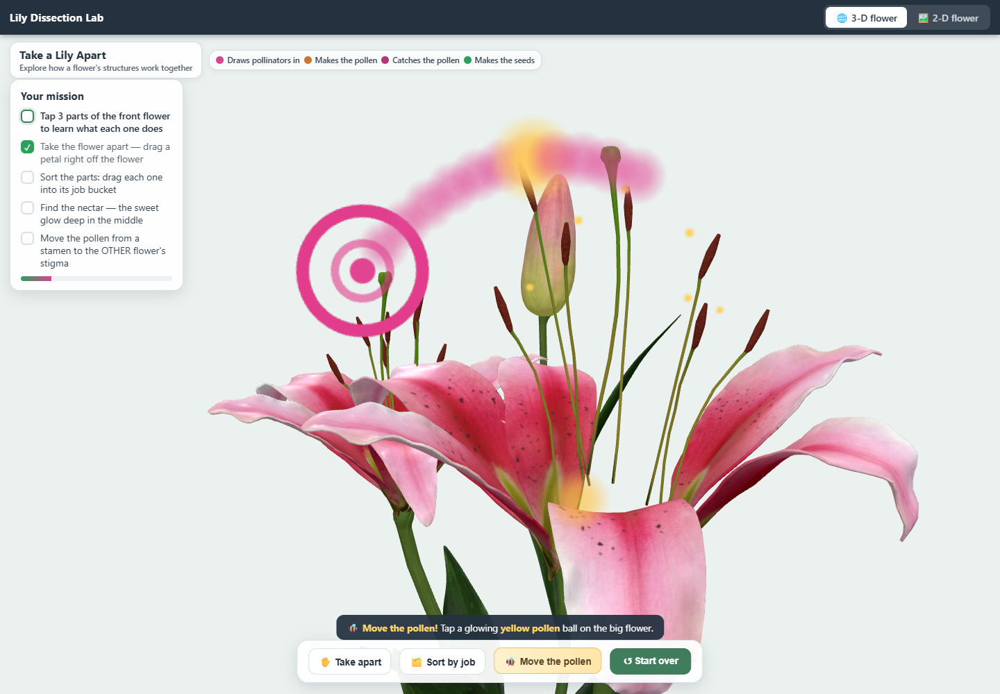
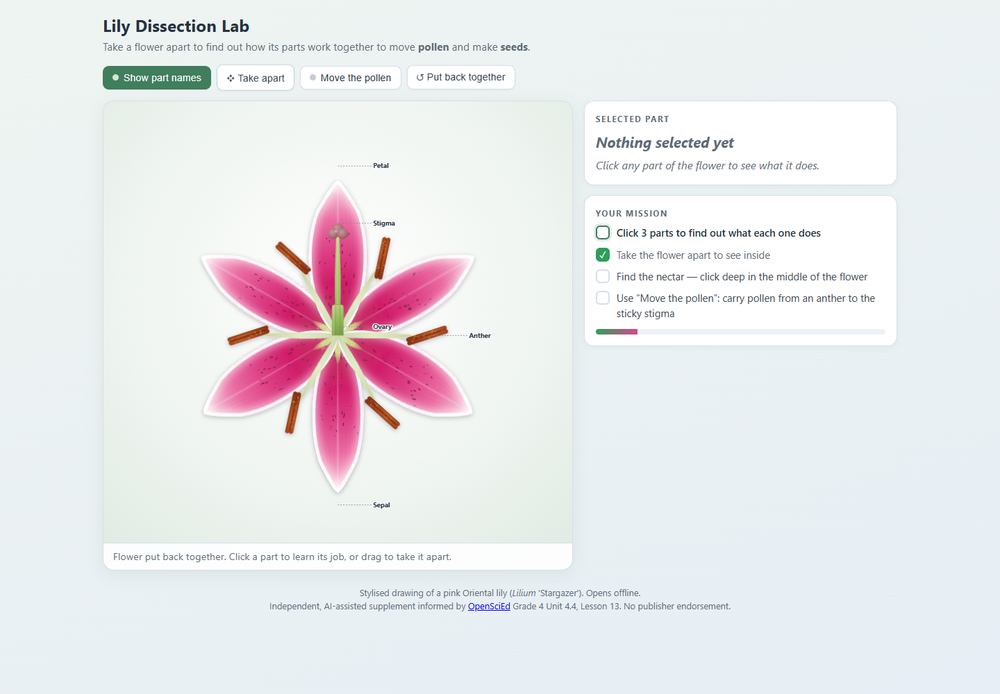

# A teacher's need becomes a working resource

Lily Dissection is the first module in Personalized STEM Resources, a speculative prototype for conversational STEM authoring. The proposed tool would let a teacher describe a lesson need, review a working preview, and ask for changes. Learning patterns and prebuilt interactions would guide the work behind that conversation.

I built the initial Lily application in under four hours using AI workflows and a rudimentary Learnability Patterns knowledge source. That is my report of the initial build, rather than a measured teacher authoring task. The present resource includes later refinements. Lily has one user, and three teachers are providing feedback on the broader project.

## Start with the lesson

The module was informed by OpenSciEd Grade 4 Unit 4.4, Lesson 13. The lesson asks students to explain how flower structures work together in reproduction. That goal shaped the activity: part functions, a simplified pollen transfer, and explanations that a teacher can use alongside the investigation.

For example, a teacher might ask:

> My class is investigating how flower structures help plants reproduce. Let them take a flower apart and see how pollen moves.

This is an illustrative request based on the module's goal; it is not a transcript of the original authoring conversation.

The proposed service would make this workflow accessible to teachers themselves. In the current example, I supplied the development and review work.

## Make the structures available for exploration

The earlier 3-D version lets learners separate the flower's structures and select them to see their functions. The reusable idea is an explorable model linked to explanations. The flower-specific assets and organ mapping belong to this module.

The design emphasis is coherence: the interaction should support the lesson's explanation of reproduction. Learning part names can help discussion, but names alone do not meet that goal.

## Make a process visible

The 3-D example shows pollen traveling between two blooms. A visible route and destination provide guidance, and completion feedback describes what happened. The learning-pattern source helped frame these choices around scaffolding and explanation.

These screenshots show current interactions. They do not establish learning gains or reproduce the initial four-hour build.

## Fit the classroom's constraints

The [module](../modules/lily-dissection/index.html) contains 3-D and 2-D views in a single offline HTML file. Its [2-D view](../modules/lily-dissection/index-2d.html) uses SVG art. It shows pollen moving within one illustrated bloom. That is a different case from the two-bloom 3-D example, and the teacher should make that distinction explicit.

The 3-D version uses a purchased TurboSquid model included in this review prototype under its separate commercial license. See [distribution notes](../THIRD_PARTY_NOTICES.md).

## What the next stage needs to establish

Catalyst support would fund the transition from this developer-led example to independent teacher authoring:

| Work | Question to test |
|---|---|
| Teacher requests, previews, and revisions | Can teachers reach a usable resource without developer intervention? |
| Pattern knowledge and reusable STEM tools | Does the combined workflow help on matched tasks compared with general-purpose AI? |
| Scientific and instructional review | Are the resources accurate, aligned, and useful in the intended lesson? |
| Classroom pilot and student work | What can students explain after using the resource, and what should change? |
| Time and cost records | What is the total effort and cost, including review, revisions, and failed attempts? |

The mission panel records actions, so evaluation needs separate student explanations or concept tasks. Scientific review also needs to address the simplified transition from pollen transfer to seed formation. Device and accessibility checks should cover actual classroom conditions.

**Insight:** Learning patterns can serve as design constraints that connect a curriculum goal, learner actions, and feedback. A fast build gives us something concrete to examine; review and classroom evidence determine whether it is a useful teaching resource.

## Technical observation

On October 11, 2026, a direct-file run in desktop Chromium exercised the earlier 3-D launch, keyboard selection, disassembly, keyboard pollen transfer, switching to 2-D, and a simulated missing-WebGL fallback. No page errors or HTTP requests occurred during those interactions. This was a limited behavior check, with no classroom participants or physical school-device testing.

The module builds and interactions are checked after repository reorganization. The [module README](../modules/lily-dissection/README.md) explains its sources and rebuild commands.

[Read the competition proposal](tools-competition-2027-proposal.md).
